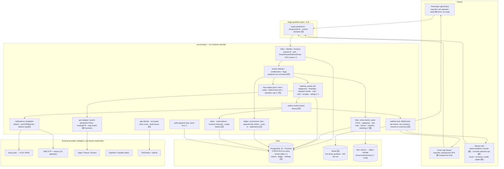

# Architecture

_Updated 2026-10-12. Target = "works and feels like Uber" for riders, drivers and operators, delivered as a
multi-tenant white-label platform. Research behind this: `UBER_PARITY.md` (patterns), `UBER_APPS_SPEC.md`
(screen-level app spec + delta), `PLATFORM_PARITY.md` (operator/super-admin side + per-tenant knobs + data model),
`SRI_LANKA_MARKET.md` (local market, payments, SMS, maps, PDPA). Legend in diagrams: **[✅]** built · **[🟡]** partial ·
**[⬜]** target._

## 1. Shape
A **Go modular monolith** (`services/api`) over **PostgreSQL 16 + PostGIS** with row-level security, one **Next.js**
web app (platform console, operator console, public booking/tracking pages), and **one Expo codebase** that builds a
passenger app and a driver app **per operator** under the operator's own store accounts (D-022, D-024). No
microservices until a measured need exists (D-001). Redis enters only for realtime fan-out and location freshness
(D-008), never as the queue — the queue is a transactional outbox in Postgres.

Rendered diagram: `docs/diagrams/architecture-target.svg`.

Production today: Docker stack on the packline server behind packline's nginx at taxios.packline.lk; a loopback-only
`taxios-dev` stack on the same server is the device-test target (`DEPLOYMENT_RUNBOOK.md`).

## 2. Multi-tenant model (spec Part 6)
- **Platform** = Taxios (super-admins, support). **Tenant** = one operator (owner/admin/dispatcher/finance/viewer/
  driver/passenger memberships). A user may belong to several tenants; the apps switch operator by code.
- **Resolution**: membership from the session, never from client input alone. **Isolation**: `FORCE ROW LEVEL
  SECURITY` + policies on `app_tenant_id()` / `app_user_id()` / `app_platform_scope()`; settings are transaction-local;
  the API role `taxios_app` cannot bypass RLS (`serve` refuses otherwise). Unknown tenant/non-member → 404.
- **Configuration layering** (target, `PLATFORM_PARITY.md` §C3): platform default → plan entitlement → tenant
  override → zone → category. ~45 knobs (dispatch policy/TTL/radius, PIN policy, cancel/no-show/wait rules, deviation
  threshold, commission, languages, contact policy, SOS numbers, templates…). Read once per request through one
  `settings.For(tenant)` hook; the apps fetch the public subset from `/v1/public/tenants/{slug}` and the private subset
  with the session. **No business constant stays hard-coded in Go once T-129 lands.**
- **Platform-scoped tables** (plans, subscriptions, invoices, usage meters, flags, support sessions, announcements,
  provider credentials) have no `tenant_id` and are readable only under `app_platform_scope()`; tenants read their own
  subscription/usage through explicit endpoints.
- **Support access** ("login as"): a normal tenant-scoped transaction with dual attribution (actor + tenant), reason
  code, TTL ≤ 60 min, persistent banner, every read/write audited (T-020).
- **Per-operator apps**: same binary, `TAXIOS_TENANT` pins the operator at build time, runtime brand + knobs from the
  API; store credentials encrypted (AES-GCM, platform key), never returned by the API; build requests queued and run
  through EAS under the tenant's accounts (T-173/T-174).
- **Other isolation targets**: cache keys `t:{tenant}:…`, WebSocket subscriptions authorised per tenant on connect,
  object keys prefixed by tenant, outbox events carry tenant context, AI retrieval through the same scoped transactions.

## 3. Request path
1. `httpx.Middleware`: `X-Request-ID`, panic recovery, one JSON log line.
2. `identity.RequireAuth`: `Authorization: Bearer txs_…` → SHA-256 → `Principal` (sliding sessions: mobile 180 d, web 30 d).
3. `TenantRoute`: transaction with `app.user_id` + `app.tenant_id`, membership under RLS (404 if none), permission
   check, writes blocked on inactive tenants, then the handler. `PlatformRoute` sets platform scope.
4. Handler returns `Result`; JSON written only after commit. State changes append `booking_events` / `audit_events` and
   (target) an `outbox_events` row in the same transaction.

## 4. Ride engine
### 4.1 Booking state machine (implemented: `booking/trip.go`; tests `mvp_test.go`)
| From | To | Actor | Notes |
|---|---|---|---|
| — | quote | passenger / dispatcher | `booking_quotes`: fare rule version, estimate, TTL (knob, 10 min). Target: one call quotes **all categories** with ETA each |
| quote | scheduled \| searching | passenger / dispatcher | `Idempotency-Key`; one booking per quote; upfront fare locked |
| scheduled | searching | worker | lead time (knob, 15 min); target: assign-ahead for Reserve-style bookings |
| searching | assigned | driver accepting an offer | booking → offer → driver locks; trip row created |
| searching | expired | worker | search timeout (knob, 10 min) → "no driver" sheet + call-operator fallback |
| scheduled/searching/assigned | cancelled | passenger / dispatcher | reason; cancel fee only after free window (knob); cash → owed balance |
| assigned | completed | driver | final fare = upfront unless deviation > threshold (knob) → GPS fare |
| assigned | cancelled | driver (`abort`) | reason; `rider_no_show` requires `arrived` + no-show wait elapsed (knob) |
Trip: `driver_assigned → en_route → arrived → in_progress → completed`; `arrived` may be auto-set by geofence (knob)
with manual fallback; the wait timer starts at the server time of `arrived`; PIN (off / night / always) must match
before `in_progress`. Terminal states never reopen. Every transition appends a `booking_events` row (append-only).

### 4.2 Dispatch
1. `dispatchNext` locks the booking, selects drivers by **policy** (knob: nearest ✅ · road-ETA ⬜ · stand FIFO ⬜ ·
   broadcast ⬜ · batch ⬜) among `driver_compliance`-clean, `available`, fresh location (knob), within radius (knob,
   expanding steps ⬜), matching category, no live offer/trip, not already offered, not a mutual-1★ pair (knob ⬜) —
   `FOR UPDATE SKIP LOCKED` — and creates an offer (TTL knob).
2. Offer delivery: WebSocket + high-priority push; the driver app acks **delivered** so an unseen offer is not counted
   as a decline (⬜). Accept: lock booking → offer → driver, re-check, create trip; unique partial indexes make double
   assignment impossible. Decline/expiry → next driver; auto-reassign on abort (knob).
3. Dispatcher board: unassigned > N min, late, stationary, route-deviation alerts; manual offer (90 s knob), reassign
   with reason, bulk actions, notes — all over the realtime hub (⬜ T-031/T-146).
4. Standing engine (⬜): rolling-500 rating mean, rolling-100 acceptance/cancellation rates nightly; floors raise
   dispatcher alerts and warn → suspend(until) → deactivate with reason + appeal note; never auto-deactivation.

### 4.3 Fares and money
- Pure engine, integer minor units, versioned rules per category (+zone) shaped like the regulated meter (D-LK-2:
  base covers the first km, then per-km, waiting per minute after grace, night band 22:00–05:00 %, peak multiplier per
  zone, holiday calendar), plus booking fee, scheduled fee, airport/zone flat, minimum, rounding to Rs 10, tax. Hire
  products (hourly/day packages with km caps, intercity one-way/return) and corporate accounts in v1.1. Surge later,
  capped, per zone; optional "meter mode" per tenant for tuk societies.
- **Upfront fare** is the contract; GPS re-pricing only when deviation > threshold or destination/stops change (both
  parties see the delta). Distance from map-matched GPS (⬜ adapter), fallback haversine.
- **Cash-first commission-credit ledger** (⬜ T-132/T-144, D-LK-4 — the PickMe/Kangaroo model): `commission_rules`
  (% / flat daily / tiered; most specific wins), append-only `ledger_entries` (fare_cash, commission, discount,
  adjustment, cash_in, payout), balance = SUM, a **negative floor per tenant** below which the driver stops receiving
  offers, top-ups by audited staff cash, bank-transfer import by reference, or wallet/LankaQR webhooks when available;
  daily/weekly statements; "owed to operator" in the driver app instead of cash-out. Card/LankaQR via PayHere
  Preapproval or the tenant's Dialog Pay QR is phase 2; card earnings credit the same ledger, payouts via CEFTS batch.

## 5. Realtime and async (⬜ T-030/T-031/T-153)
- **Outbox**: every state change writes `outbox_events` (tenant, aggregate, type, seq, payload) in the same
  transaction; a worker in the same binary delivers with stable IDs; consumers dedupe on event ID.
- **Hub**: one WebSocket per app session, authorised per tenant on connect; per-booking sequence numbers; client sends
  last-seen seq on reconnect and the hub resends; server heartbeat 4 s, client reconnects after 7 s silence; only the
  latest state per booking is pushed; polling every 5–10 s stays as fallback. Fan-out via Redis when multi-instance.
- **Driver locations**: 4–5 s on trip, 10–15 s idle, 30 s heartbeat when stationary; batched + replayed after
  reconnect; latest position in Redis, history in `location_updates` (retention knob). Plausibility checks (speed,
  altitude jumps, mock-location flag, GPS/routed distance ratio) raise `fraud_flags` for human review.
- **Notifications**: a server-side policy maps booking events → push / SMS / email / Live Activity, debounced ≤ 1 per
  5 s per booking; templates per event × channel × language with a delivery log and cost. Offers use high-priority push
  with sound. SMS = local gateway (Notify.lk / Text.lk / Dialog eSMS) with a **tenant-registered 11-char sender ID**
  (platform fallback), Sinhala/Tamil templates ≤ 70 chars per segment, no promotional SMS 20:00–08:00; push first,
  SMS when unacked for 20 s on arrived/trip events; Twilio only as cross-border fallback (D-LK-5).
- **Offline tolerance**: apps cache recents/saved places and the last booking state; driver actions (arrived/start/end/
  cash) carry idempotency keys and replay in order.

## 6. Clients
- **Passenger app** (`UBER_APPS_SPEC.md` §1/§4.1): map + bottom sheet on every live state; phone-first OTP sign-up;
  "Where to?" home with saved/recent places and nearby vehicles; two-field search with landmark POIs and pin-on-map;
  product rows with upfront price + ETA; payment row (cash explicit); searching with free cancel and call-operator;
  en-route with live marker, call/share/safety shield; arrived banner with PIN + wait timer; on-trip with ETA; end with
  "pay driver Rs X cash", rating chips, SMS receipt; Activity, Reserve (date picker, airport), account/settings
  (si/ta/en), safety toolkit (119/1990 + dispatcher alert), public share page `https://<tenant>/t/<token>`.
- **Driver app** (§2/§4.2): map-first home with earnings pill and status strip; documents with expiring state;
  earnings-first offer card (fare, pickup ETA, trip length, destination, rider rating, countdown ring, sound);
  in-app map + nav chooser; geofence "arrived", wait timer, PIN entry, no-show cancel; swipe to start/complete; cash
  screen with commission line; rate rider; earnings tab with owed-to-operator balance and statements; background
  location (EAS dev build); SOS.
- **Operator console** (`PLATFORM_PARITY.md` §C2): live map, dispatch board with alerts, phone bookings with SMS
  tracking link, zones/categories/fares/surcharges, drivers pipeline + standing, vehicles, ledger/settlements, customers
  CRM, reports, branding + app identity + website, notification templates, team roles, settings (all knobs), support.
- **Platform console** (§C1): tenant lifecycle, plans/entitlements/flags, usage + revenue, global audit, support
  access, announcements, build queue, domains, fraud review, PDPA request queue, health.
- **Geo adapter** (D-LK-6/7): tenant POI table (junctions, temples, kovils, schools, bus halts, hospitals, hotels) with
  si/ta/en aliases + trigram search ranked first, then self-hosted Nominatim/Photon and OSRM/Valhalla on the Geofabrik
  LK extract for search, quotes, matrix and map-matching; Google Places/Routes only where a tenant enables (and pays
  for) live-traffic ETA; a learned per-zone/hour speed table corrects ETAs from our own trips.
- **Design rules**: patterns only, never Uber's trade dress; neutral UI with the operator's colour on primary actions,
  selections and the route line; trilingual (en/si/ta, Noto Sans Sinhala/Tamil bundled, driver app icon-led) from day
  one; low-end Android is the floor (D-LK-10): minSdk 28, APK ≤ 30 MB, cold start ≤ 3 s and TTI ≤ 5 s on 3G-class
  2 Mbps, booking payloads ≤ 10 KB, offline queue for status changes, map tiles cached for the last zones.
- **Compliance** (D-LK-12): PDPA Parts I & III apply from 1 Jan 2027 — DPO fields per tenant and platform, breach
  runbook, DPIA on location data, data-residency option, consent copy in si/ta; NTC (Amendment) Act No. 8 of 2025 puts
  tuks and ride-hailing under the NTC — exportable driver/vehicle register (NIC, licence class, CR, revenue licence,
  insurance, WP permit); VAT 18 % + SSCL lines on operator invoices.

## 7. Module dependency order (build sequence)
settings/entitlements → outbox + realtime hub → notifications (push, SMS) → geo adapter (search/route/ETA/map-match) →
app rewrite (map-first) → ledger/settlements → billing (plans, invoices, usage) → app identity + builds → domains →
integrations (API keys, webhooks) → AI → marketplace → licensing. Lock order stays booking → offer → driver.
